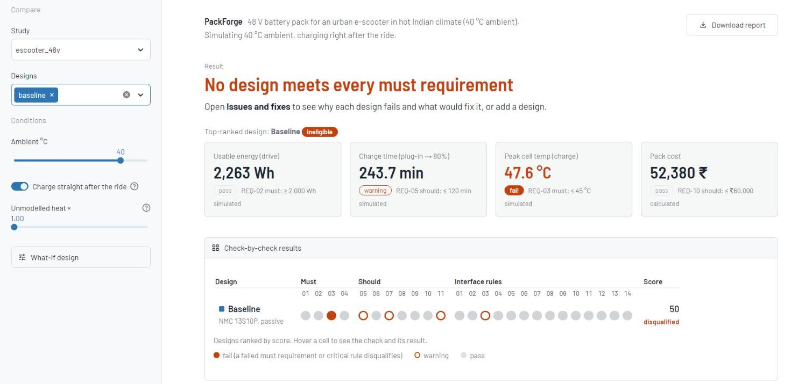
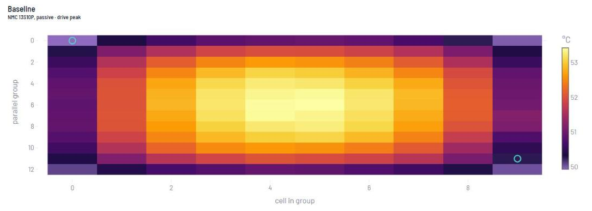
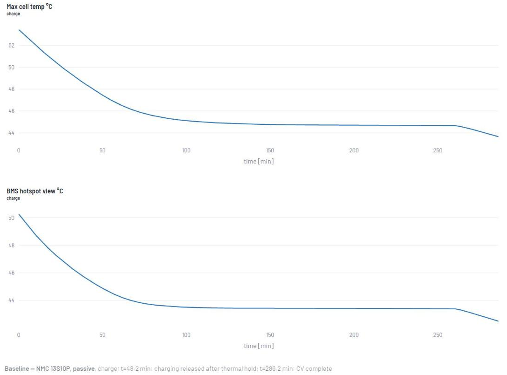
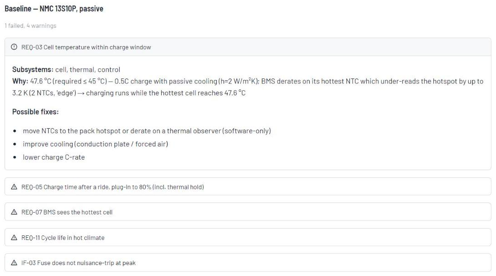
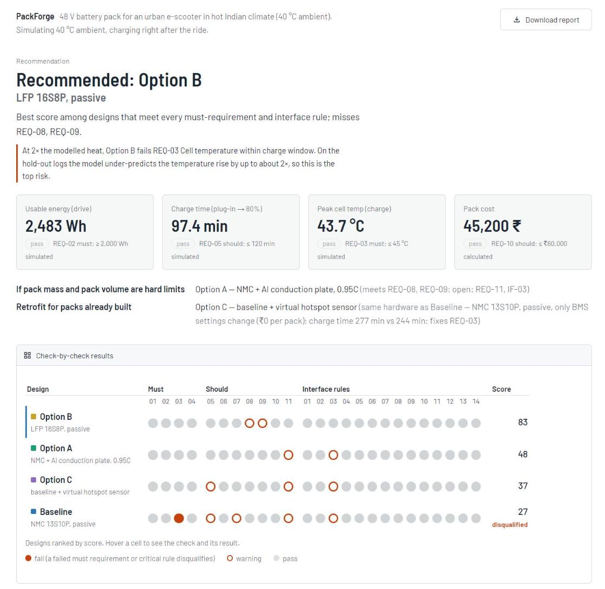
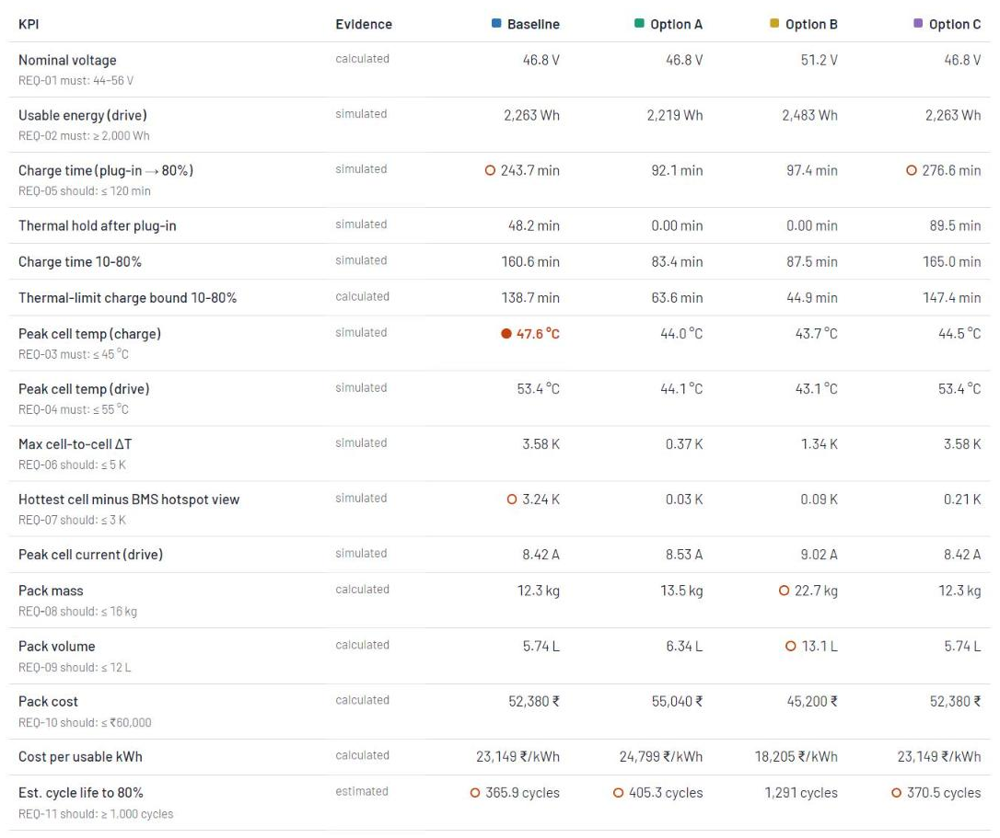
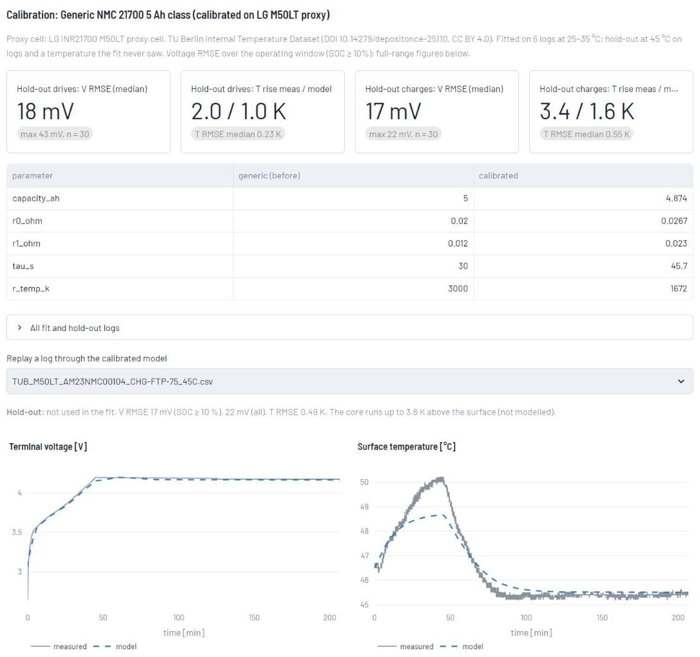
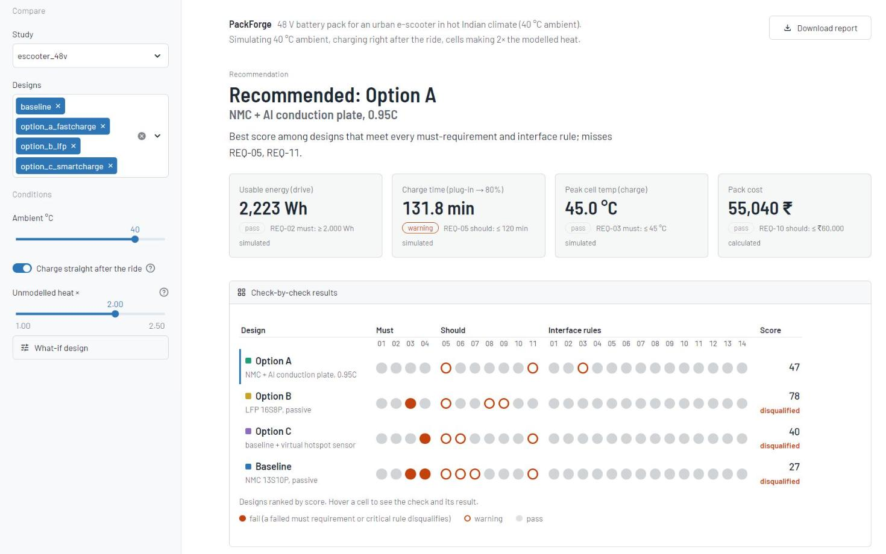

<div align="center">

# 🔋 PackForge

**A reusable cell-to-pack battery design workbench: simulate design options against an application's
requirements, find the conflicts between subsystems, and recommend one with its risks stated.**


[Overview](#overview) · [Key results](#key-results) · [Walkthrough](#walkthrough) · [Getting started](#getting-started) ·
[Usage](#usage) · [How it works](#how-it-works) · [Evidence](#evidence-and-validation) ·
[Extending](#extending-packforge) · [VoltTwin Studio](#volttwin-studio-src)

</div>

## Overview

PackForge was built for **TELIPORT Season 4 (Tata Elxsi), Case Study 2: "Reusable Digital Platform for Designing
Battery Energy System"**. The platform is generic: any cell, any S×P layout, cooling, sensing, protection and BMS
control. The example study is one hard case: a **48 V e-scooter pack at 40 °C ambient, charged right after a
ride**.

That case shows why cell-level modelling matters. After a ride, the baseline pack's two edge NTCs cool first and
read the hottest cell 3.2 K low. The BMS waits 48 min, then charges interior cells at 47.6 °C, above their 45 °C
limit. Nothing on the BMS shows it. PackForge finds this before any hardware is built, explains the cause, and
compares fixes.

What it does:

- **Electro-thermal simulation** of every cell in the pack, with a BMS control loop (CC-CV, derating, OV/UV/OT
  protection) that sees only its sensors.
- **Conflict checker**: 11 requirements and 14 interface rules. Each failure comes with a cause chain across
  subsystems and candidate fixes.
- **Sensor blind-spot detection**: how far the hottest cell runs above what the BMS acts on.
- **Virtual hotspot sensor**: a BMS-side thermal observer, offered as a ₹0 firmware retrofit.
- **Three-part recommendation**: the best eligible design, the best one that meets the targets the first one
  misses, and a firmware-only retrofit for packs already built.
- **Robustness re-run** with extra heat that the BMS is not told about. Monte Carlo cell-to-cell variation.
- **Evidence-ladder traceability**: requirement → metric → assumption. Every number is tagged from *datasheet*
  up to *measured*.
- **Cell model fitting** from measured logs, with a hold-out check on data the fit never saw.
- Streamlit UI, CLI, and a self-contained offline HTML report, all built on one core.

## Key results

E-scooter study, 40 °C ambient, plugged in right after the ride. All values come from
`python -m packforge`.

| | Baseline: NMC passive | A: NMC + Al plate | B: LFP 16S8P | C: baseline + observer |
|---|---|---|---|---|
| **Charge time (plug-in → 80 %)** | 244 min | 92 min | 97 min | 277 min |
| of which thermal hold | 48 min | 0 | 0 | 90 min |
| Peak cell temperature while charging | **47.6 °C (fails)** | 44.0 °C | 43.7 °C | 44.5 °C |
| Hottest cell − BMS view | 3.2 K | 0.0 K | 0.1 K | 0.2 K |
| Mass | 12.3 kg | 13.5 kg | 22.7 kg | 12.3 kg |
| ₹ per usable kWh | 23.1 k | 24.8 k | 18.2 k | 23.1 k |
| Est. cycle life | ~370 | ~405 | ~1,290 | ~370 |
| **Ranking** | disqualified | 2nd | **1st** | 3rd |

**Recommendation:** **B** (LFP) for new packs. **A** if mass and volume are hard limits. **C** as a ₹0 firmware
retrofit for 2-NTC packs already built. C is safe but slower after a hot ride.

> [!WARNING]
> The LFP cell behind the recommended design is **not validated**. If cells make 2× the modelled heat, B misses
> the charge limit by 0.02 K and A becomes the pick. The next step is one LFP charge test through the same fit
> pipeline. No design is claimed to be AIS-156 compliant.

## Walkthrough

The e-scooter study, step by step in the workbench UI. Start it with `.venv/Scripts/streamlit run app.py`, keep
only **baseline** under **Designs**, and leave ambient at 40 °C with **Charge right after the ride** on. The steps
follow the live demo in [`docs/DEMO_SCRIPT.md`](docs/DEMO_SCRIPT.md).

### 1. The baseline fails after a ride



The page leads with its verdict. Each circle in the grid is one check. The solid orange one is REQ-03: the hottest
cell reaches 47.6 °C while charging, against a 45 °C limit, and a failed *must* requirement disqualifies the
design. Rings are warnings. Hover a circle to see the check and its result. Turn **Charge right after the ride**
off and the same pack passes at 44.7 °C, so the hot plug-in is what breaks it.

### 2. Find where the heat is



**Heat map** shows every cell at the moment the hottest one peaked. After the ride the interior cells run near
53 °C. The two BMS sensors (rings) sit on corner cells, which cool first.

### 3. Compare the hottest cell with what the BMS sees



**Time series** puts the hottest cell (top) above the temperature the BMS acts on (bottom). The BMS reads low for
the whole charge, by up to 3.2 K. It holds charging for 48 min, then charges while the hottest cell is still above
45 °C. No alarm fires and nothing trips.

### 4. Read the cause chain and the fixes



**Conflicts** lists every failure and warning with the subsystems involved, the cause chain and candidate fixes.
The first fix, derating on a thermal observer, is what Option C does in firmware only.

### 5. Add the options and get a recommendation



Add `option_a_fastcharge`, `option_b_lfp` and `option_c_smartcharge`. PackForge recommends **B** (LFP), names
**A** as the pick if mass and volume are hard limits, and **C** as a ₹0 retrofit for packs already built. The
grid ranks the designs by score; Baseline stays disqualified.



**Compare** gives every KPI with its evidence level and the requirement it is checked against. Values that miss a
limit carry the same marks as the grid.

### 6. Check the model against measured data



**Validation** shows how the calibrated NMC cell model does on 45 °C logs the fit never saw. The replay above is
a hold-out charge: 17 mV voltage error, but the model under-predicts the temperature rise about 2×. The tab also
states that the LFP cell is not validated.

### 7. Stress the recommendation



Because the temperature rise is under-predicted, set **Unmodelled heat ×** to 2.0. Every cell now makes twice the
modelled heat and the BMS is not told. B misses the charge limit by 0.02 K and the recommendation switches to A.
One LFP charge test settles which one to build.

### 8. Take the report

**Download report (HTML)**, top right, saves the KPIs, conflicts, recommendation, the 2× heat re-run and the
validation as one offline file. Set the heat factor back to 1.0 first: the report captures what is on screen.

## Getting started

### Prerequisites

- Python 3.10 or later
- Windows commands are shown. On Linux/macOS use `.venv/bin/` instead of `.venv/Scripts/`.

### Install

```bash
python -m venv .venv
.venv/Scripts/python -m pip install -e ".[dev]"
```

> [!NOTE]
> `pytest` is pinned below 9.2 because 9.2.0 crashes with an `INTERNALERROR` in this setup.

## Usage

### Workbench UI

```bash
.venv/Scripts/streamlit run app.py
```

Above the tabs, the page leads with the recommendation and a requirement grid: one row per design, ranked, and one
circle per requirement or interface rule (solid orange = fail, ring = warning, grey = pass). The sidebar picks the
study and designs. It also sets ambient temperature, whether the charge starts right after
the ride, and the **Unmodelled heat ×** factor. A what-if panel varies parallel count, C-rate, derating window,
cooling and sensor layout.

| Tab | Shows |
|---|---|
| Compare | KPI table with evidence levels and the requirement each KPI is checked against, trade-off radar |
| Time series | Charge and drive signals per design, with BMS events |
| Heat map | Cell temperatures at the peak, with BMS sensor positions |
| Conflicts | Failures and warnings with cause chains and candidate fixes |
| Traceability | Requirement → metric → assumption matrix, design JSON download |
| Monte Carlo | Spread of energy, charge time and peak temperature over sampled packs |
| Validation | Calibration and hold-out results, log replay, fit your own log |

### Command line

```bash
# Compare all designs in a study, print conflicts, ranking, recommendations and the 2x heat re-run
.venv/Scripts/python -m packforge studies/escooter_48v --report packforge_report.html

# Options: --mc N (Monte Carlo samples per design), --stress F (unmodelled-heat factor, 1 = off)

# Fit a cell model to a measured log (current > 0 = discharge)
.venv/Scripts/python -m packforge.fit data/validation/<log>.csv --cell nmc21700_5ah [--free r_temp_k ocv] [--save]
```

> [!TIP]
> The whole e-scooter study, including the robustness re-run, takes about 30 s on a laptop. The report is a
> single offline HTML file with every figure embedded.

### Tests

```bash
.venv/Scripts/python -m pytest -q   # ~90 s
```

The tests check energy and heat balance, CC-CV behaviour and chained scenarios. They compare the simulation with
an independent hand-calc bound and check the observer at ±30 % model error. They also cover conflict detection,
ranking, Monte Carlo batching, fit recovery, the hold-out prediction, the recommendation roles and the report
content.

## How it works

```
study.json + design JSONs ─► loader ─► Design (single source of truth)
   ─► sim: drive, then charge from the drive's end state (per-cell electro-thermal + BMS loop)
   ─► metrics (KPIs + evidence level) ─► checks (requirements + interface rules)
   ─► rank · recommend · traceability · report
```

Subsystem models exchange values only through the `Design` and the metrics dict. This is the brief's "consistent
parameter exchange".

- **Cell:** OCV(SOC) table + R0 + one RC branch. Resistances scale with temperature (Arrhenius).
- **Thermal:** one node per cell. Heat is I²R0 + V_rc²/R1. Heat leaves to the sink through an effective h over
  the cell surface (more at the pack edge) and conducts to 4 neighbours.
- **BMS:** derates on its hottest NTC, or on an observer that runs a nominal thermal model corrected by the NTCs.
  Plugging in above the derate window is a *thermal hold*, not a trip.
- **Sanity checks:** a 2 s time step (KPIs within 0.4 % of 1 s), an adiabatic heat balance within ±2 %, and a
  hand-calc thermal-limit bound that the simulation must track.

```
packforge/   schema · loader · sim · metrics · checks · engine · fit · figures · ui · report · CLI
app.py       Streamlit UI (rendering only)
data/cells/  cell JSON (id = file name)          studies/<name>/  study.json + one JSON per design option
data/validation/  logs, calibration record, SOURCES.md          scripts/  data conversion and calibration
docs/        demo script, screenshots, offline backups      tests/  physics, checks, calibration, recommendations
```

## Evidence and validation

The NMC cell is calibrated on a **proxy cell**: the LG INR21700 M50LT, from the public TU Berlin *Lithium-Ion
Battery Internal Temperature Dataset*. It is fitted at 25 and 35 °C and checked on **60 hold-out logs at
45 °C** that the fit never saw.

| Hold-out set | Logs | V RMSE, SOC ≥ 10 % (median / max) | T RMSE (median) | T rise meas / model |
|---|---|---|---|---|
| Drive cycles | 30 | 18 / 43 mV | 0.23 K | 2.0 / 1.0 K |
| 1C charges | 30 | 17 / 22 mV | 0.55 K | 3.4 / 1.6 K |

The voltage holds at a temperature the fit never saw. The temperature rise is under-predicted about 2×, so every
design is also run with 2× unmodelled heat.

> [!IMPORTANT]
> - Proxy-cell results are labelled *measured (proxy)*. Only cell-intrinsic parameters transfer to a pack. The
>   test rig's chamber cooling is never transferred.
> - LFP values, costs and masses are generic class values, not a named datasheet.
> - `SYNTHETIC_*` logs are generated by PackForge's own model. They are a method check for the fitter, never
>   evidence.

To reproduce the calibration (about 15 min), download the dataset as described in
[`data/validation/SOURCES.md`](data/validation/SOURCES.md), then run:

```bash
PYTHONPATH=scripts .venv/Scripts/python scripts/calibrate_nmc.py
```

Known limitations are listed in [`ROADMAP.md`](ROADMAP.md#known-limitations-state-them-openly).

## Extending PackForge

| To add | Do this |
|---|---|
| A cell | Copy a file in `data/cells/` and fill in `sources` and `assumptions`, or fit one from a log with `packforge.fit --save` |
| A design option | Add `studies/<study>/option_x.json` with `"extends": "baseline.json"` and only the differences |
| A study | Add `studies/<name>/study.json` (application, ambient, scenarios, requirements, score weights) plus design files |
| A requirement | Add it to `study.json` (its `metric` must be in `METRICS`) and an `EXPLAIN` entry in `checks.py` |
| An interface rule | Add an `IF-nn` tuple to `interface_checks` in `checks.py`. `critical=True` disqualifies |

A design option only needs its differences from the baseline:

```json
{
  "extends": "baseline.json",
  "id": "option_c",
  "name": "Option C — baseline + virtual hotspot sensor",
  "control": {"charge_c_rate": 0.95, "derate_on": "observer", "derate_start_c": 43.5, "derate_end_c": 44.5},
  "assumptions": [
    {"id": "A-C1", "text": "BMS MCU can run a 130-node thermal model at 0.5 Hz (no BOM change)", "affects": ["control", "cost"]}
  ]
}
```

## VoltTwin Studio (`src/`)

VoltTwin is a second, simpler implementation of the same brief, built phase by phase from
[`TASK.md`](TASK.md). It lives next to PackForge and shares no code with it. It covers a three-way study (baseline
NMC + passive air, option A LFP + forced air, option B NMC + Al-fin/PCM) with seven hard requirements, a coupled
physics engine, conflict rules, TOPSIS ranking, a REST API, a Streamlit workbench, a report and a 1S-4P bench
protocol.

```bash
.venv/Scripts/python -m pip install -e ".[dev,volttwin]"       # adds FastAPI, uvicorn, PyBaMM, httpx
.venv/Scripts/python run_demo.py --cli-only                     # terminal demo; exit 0 = verdicts match Round-1
.venv/Scripts/python run_demo.py                                # + API on :8000/docs and workbench on :8501
.venv/Scripts/streamlit run src/workbench/app.py                # workbench only
.venv/Scripts/uvicorn src.api.main:app                          # API only
.venv/Scripts/python run_demo.py --cli-only --report volttwin_report.html
```

```
src/config.py            ambient 40 °C, limit 50 °C, BMS cutoff 55 °C, REQ-EL-01 … REQ-EC-01
src/models/              pydantic specs (every entry has a source) · SQLite repository seeded from data/datasheets/*.json
src/physics/             electrical · thermal (lumped, PCM, derating) · pybamm_runner · mechanical_bom · replay · targets
src/validator/           conflict_engine (CF-TE / CF-EM / CF-PS) · traceability · topsis_recommender
src/pipeline.py          simulate → conflicts → rank → trace → Round-1 comparison (used by API, UI, report, demo)
src/api/main.py          GET /health, /datasheets · POST /simulate, /compare
src/workbench/           app.py (Streamlit) · plots.py · views.py · report_generator.py (report + 1S-4P protocol)
run_demo.py              seed, simulate, verify, print, report, launch
```

### Model

| Subsystem | Equations |
|---|---|
| Electrical | V = S·V_cell · C = P·C_cell · E_usable = S·P·V_nom·C_cell·DoD · R_cell = R0·1.15 (BoL margin) · R_busbar = (S+1)·ρL/(t·w)/P |
| Thermal | one enthalpy node: dH/dt = N·(I²R − I·T·dU/dT) + I²R_busbar − (T − T_amb)/R_th; T(H) holds at the PCM melt point until the latent heat is used up; hottest cell T_core = T + q_cell·R_core |
| Duty cycle | ride at 0.5 C from 90 % to 10 % SoC at 40 °C, then fast charge 10 → 80 % at the design C-rate, with and without BMS derating (linear 50 → 55 °C) |
| PyBaMM | SPMe + lumped thermal on Marquis2019 (NMC) / Prada2013 (LFP) reference cells. Mean heat / I² is scaled by capacity to give an effective R. Effective R is 0.60–0.65× the datasheet R0, and the verdicts are unchanged |
| Packaging and cost | V = N·V_cell/(π/4)·1.6 + BMS bay + cooling · mass and $ = itemised sums (assumptions A-ME-xx, A-EC-xx) |
| Ranking | margin score 50·(1 + headroom/span), clipped to 0–100 · TOPSIS on six weighted criteria · UNSAFE / REJECTED / OPTIMAL / ACCEPTABLE |

### Results and findings

| | Baseline | Option A | Option B |
|---|---|---|---|
| Peak cell temperature, no derating | 58.4 °C ✗ | 46.3 °C | 45.5 °C |
| 10–80 % with BMS derating | 56 min ✗ | 44 min | 38 min |
| Mass / volume | 13.8 kg / 8.5 L | 19.9 kg ✗ / 12.1 L ✗ | 15.6 kg / 9.4 L |
| BOM | $314 | $346 | $356 |
| Verdict | UNSAFE | REJECTED | **OPTIMAL** |

- **The verdicts match the Round-1 submission. Three values do not:** the baseline's derated charge time, option
  A's peak temperature and option A's cost. Each reason is listed in `src/physics/targets.py`, and the tests fail
  if a listed gap closes or a new one opens.
- **The recommendation is fragile.** Replaying the real TU Berlin logs through VoltTwin's unfitted datasheet cell
  under-predicts the measured temperature rise 2–4×. At 1.5× cell heat, option B exceeds 50 °C (UNSAFE). The
  workbench, report and demo show this sweep next to the recommendation. The 1S-4P bench test (expected peak
  ΔT 13.9 K at 25 °C lab ambient) is designed to measure the real heat factor.
- **Both the baseline and option A have protection too small for their peak current.** At 2 C they draw
  115 A / 106 A, and both the fuse and the BMS are rated at 100 A.

### Known limitations

One lumped thermal node instead of 3D or CFD. Contact resistance is uniform. Cell resistance is held at its 25 °C
value. Cell, cooling and BOM values are class estimates, and only NMC has measured (proxy) data; the LFP cell is
not validated. The Round-1 numbers are targets, not measurements. No design is claimed compliant with AIS-156.

## Resources

- [`TASK.md`](TASK.md): VoltTwin implementation tracker (all phases done; deviations noted per phase)
- [`ROADMAP.md`](ROADMAP.md): status, full results, pitch storyline, limitations and risks
- [`GLOSSARY.md`](GLOSSARY.md): project terms (pack, blind spot, thermal hold, charge time, proxy cell…)
- [`docs/DEMO_SCRIPT.md`](docs/DEMO_SCRIPT.md): timed live-demo walkthrough and backup-clip shot list
- [`data/validation/SOURCES.md`](data/validation/SOURCES.md): dataset attribution. Yao, Droese, Kowal, TU Berlin,
  DOI [10.14279/depositonce-25110](https://doi.org/10.14279/depositonce-25110),
  [CC BY 4.0](https://creativecommons.org/licenses/by/4.0/)
